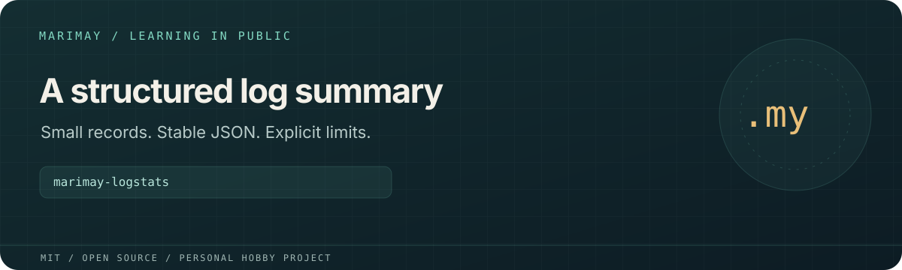

# marimay-logstats



> **Personal learning project.** This open-source MIT project is part of
> [Marimay](https://github.com/marimay-lang/marimay), my hobby programming-language project.
> I maintain it in my spare time to learn by building. APIs and tooling may
> change, and progress may be intermittent.

Aggregates strict `LEVEL<TAB>EVENT` log records into one compact JSON report with line, level and event counts.

**Status:** Experimental Marimay learning application. Process acceptance scripts exercise
VM and native Debug/Release execution. Full platform and performance acceptance
remain in progress; existing reports retain their recorded revisions and limits.

## Run and verify

```sh
mmay run . -- --help
mmay run . --allow-read . -- fixtures/sample.txt
mmay fmt . --check
mmay check .
mmay test . --engine both
MMAY="$(command -v mmay)" python3 tools/acceptance.py
mkdir -p build
mmay build . --release --allow-read . --output build/marimay-logstats
```

Install a compatible `mmay` and use its matching standard library. Application
arguments follow `--` in `mmay run`. Filesystem and environment access requires
explicit grants; native grants are selected at build time.

Levels are `DEBUG`, `INFO`, `WARN` and `ERROR`. Every record has exactly one tab
and a non-empty event. Events retain first-seen order. Multiple files are read
in order; `-` selects stdin. Line length and unique-event limits are explicit.
The report is emitted after validation of all inputs and is limited to 1 MiB.

Python generates synthetic inputs and drives independent process checks;
application logic is written in Marimay. `MMAY=/absolute/path/to/mmay` selects
the compiler for Python drivers. `python3 tools/measure.py` runs the existing
measurement harness and writes local reports under `build/`.

See [`BUDGETS.md`](BUDGETS.md), [`ERGONOMICS.md`](ERGONOMICS.md), [`VERIFICATION.md`](VERIFICATION.md) for project-specific budgets,
findings and historical verification details.

## License

[MIT](LICENSE). Existing copyright attribution is retained.
